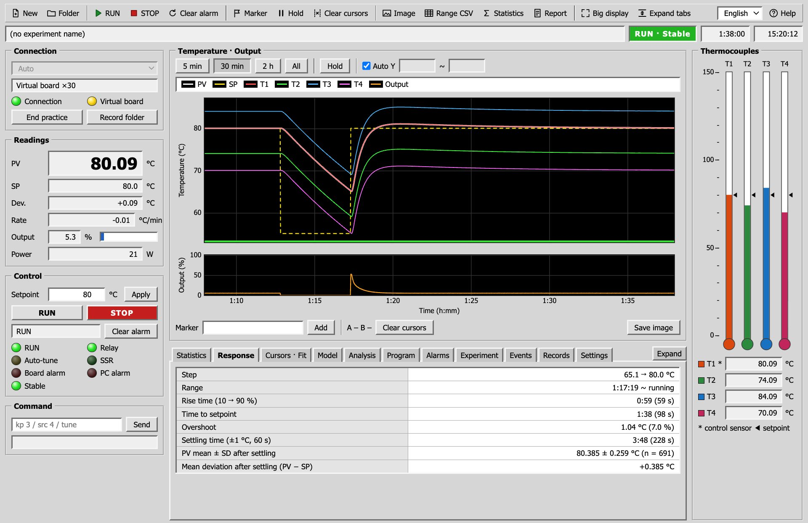

# Band Heater PID Controller

[한국어](README.md)

PID control of a 220 V, 400 W band (coil) heater with an Arduino Nano.

- Temperature: four type-T thermocouples, four MAX31856 (shared SPI, separate CS)
- Output: SSR (Autonics SRH1-1210), time-proportioned, 2 s period
- Protection: safety relay, over-temperature cut-off, sensor fault detection, no-response detection, watchdog
- Display: three 1602 I2C LCDs (0x27 control, 0x26 thermocouples, 0x25 mains state), four buttons
- PC: serial logger (CSV, live chart, statistics and step-response metrics, analysis charts, time-constant fit, temperature programs, PC alarms, comparison with past records, reports; Korean and English)

The detailed documents (assembly guide, pin map, drawings) are in Korean. This page covers what is needed to build the firmware and run the logger.

## Status

| Item | Status |
|---|---|
| Firmware v1.4 | Compiles for the Nano, passes the PC simulation. Not verified with three real LCDs and the heater |
| Schematic rev 1.2 | Passes the project's own connectivity check. KiCad ERC not run |
| Enclosure (3D print) | Passes the interference check on the model. Not printed |
| Logger | Verified with the virtual board. On the real board only connection and logging were checked (run, program and alarm were not) |

## Pins

| Function | Nano pin |
|---|---|
| MAX31856 SCK / SDO / SDI | D13 / D12 / D4 |
| MAX31856 CS (TC1–TC4) | D10 / D9 / D8 / D7 |
| SSR | D6 |
| Safety relay | D5 |
| Alarm LED | D11 |
| Buttons SET / UP / DOWN / RUN | A0 / A1 / A2 / A3 |
| LCD SDA / SCL | A4 / A5 |

## Firmware

Open `band_heater_pid/band_heater_pid.ino` in the Arduino IDE, select Arduino Nano (ATmega328P, Old Bootloader) and upload.
The LiquidCrystal I2C library is required.

Serial commands (115200): `sp 150`, `spt 150`, `kp 3`, `ki 0.01`, `kd 30`, `out 100`, `src 1~4/avg/max`, `run`, `stop`, `tune`, `clear`, `show`.
`spt` changes the setpoint without writing it to EEPROM (v1.4); the logger uses it for temperature programs.

## Logger

Nothing to install if you have [uv](https://docs.astral.sh/uv/).

```sh
uv run heater_log.py --lang en          # in the browser
uv run heater_app.py --lang en          # in its own window
uv run heater_log.py --sim 30 --lang en # practice with a virtual board, no hardware
packaging/build_mac.sh                  # macOS application (dist/)
```

The language can also be changed from the toolbar; the choice is kept in `설정.json` in the record folder.
Records go to `~/Documents/밴드히터_기록`, four files per experiment: `.csv` (one row per second), `_events.txt`, `_raw.log`, `_meta.json`.
Opening the port resets the Nano, so start the logger before starting a run.



| Part | What it does |
|---|---|
| Toolbar | New record, record folder, run / stop / clear alarm, marker, hold, clear cursors, save image / range CSV / statistics / report, big display, language, help |
| Chart | PV, SP, T1–T4, output. Drag to select a range, wheel to zoom, click for cursors A/B, manual Y range, hold |
| Statistics | Mean, SD (n−1), min, max, slope, mean power and energy (estimate) over the range. Saved as `_stats.tsv`; the range can be saved as CSV |
| Response | Rise time (10→90 %), overshoot, settling time (±1 °C, 60 s) and mean ± SD after settling for the most recent run |
| Cursors · Fit | Fits T∞ + ΔT·exp(−t/τ) between A and B |
| Model | First-order plus dead-time model (K, τ, θ) fitted to the visible range |
| Analysis | Heating rate, deviation PV−SP, channel spread, histogram, output vs temperature, temperature profile along the rod |
| Program | Steps with setpoint, rate (°C/min) and hold time; cycles; named presets. The PC moves the setpoint with `spt` |
| PC alarms | Per-channel high limits and maximum channel spread. They work only while the PC is running and do not replace the protection in the firmware |
| Records | List of past records; open one in the same tools or overlay it on the live chart |
| Report | Experiment info, settings, chart, tables and the event log in one HTML file |

## Caution

This project switches 220 V. Do not omit the residual-current breaker, fuse, earth connection and over-temperature thermostat. Wire with the power unplugged.

The repository is the record of building one device. As the status table says, parts of it have not been verified on hardware.
If you build from it, check the circuit and settings yourself, and do not leave the heater running unattended.

## License

[MIT](LICENSE). Firmware, schematic, 3D models, documents and the PC program are all under the same terms. No warranty.
