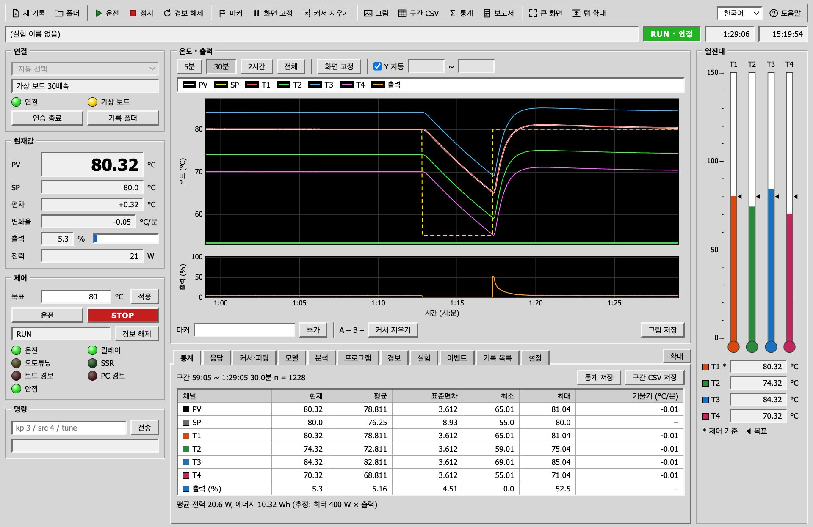
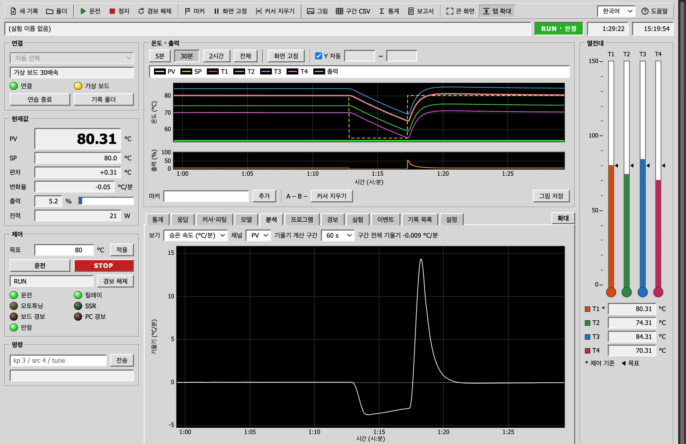
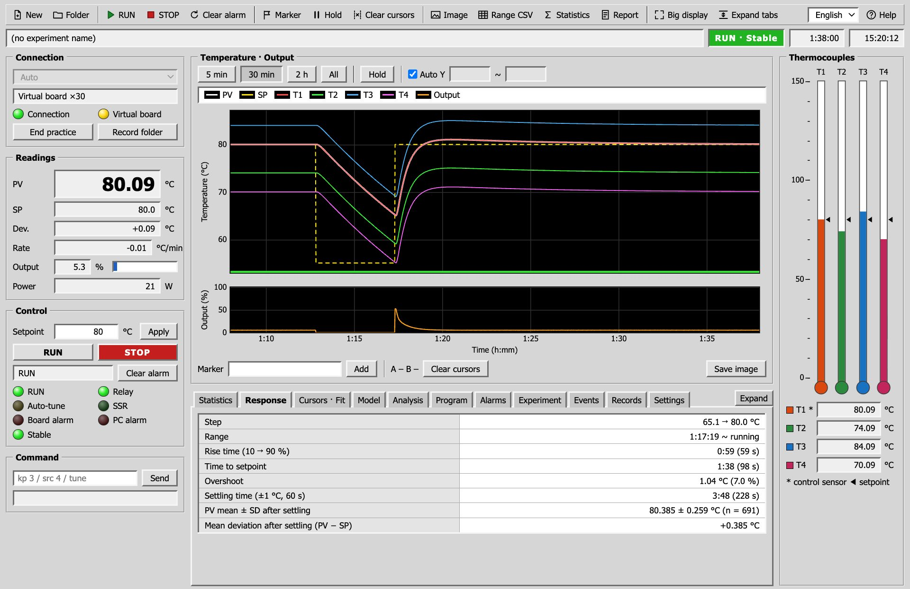

# 밴드 히터 PID 컨트롤러

[English](README.en.md)

아두이노 나노로 220V 400W 밴드(코일) 히터를 PID 제어한다.

- 온도: T형 열전대 4개, MAX31856 4개 (SPI 공유, CS만 따로)
- 출력: SSR(Autonics SRH1-1210) 시분할, 2초 주기
- 보호: 안전 릴레이, 과열 차단, 센서 고장 감지, 가열 무반응 감지, 워치독
- 표시: 1602 I2C LCD 3개 (0x27 제어, 0x26 열전대 4개, 0x25 220V 상태), 버튼 4개
- PC: 시리얼 기록 프로그램 (CSV 저장, 실시간 차트, 통계와 응답 지표, 분석 차트, 시정수 피팅, 온도 프로그램 운전, PC 경보, 지난 기록 비교, 보고서. 한국어·영어 화면)

## 상태

| 항목 | 상태 |
|---|---|
| 펌웨어 v1.4 | 나노용 컴파일, PC 모의 시험 통과. 실물 LCD 3개와 히터로는 미확인 |
| 회로도 rev 1.2 | 자체 연결 검사 통과. KiCad ERC 미실행 |
| 통(3D 출력) | 모형 간섭 검사 통과. 출력과 끼움 미확인 |
| 기록 프로그램 | 가상 보드로 검증. 실물 보드에서는 연결과 값 받기만 확인 (운전, 프로그램, 경보는 미확인) |

## 폴더

| 경로 | 내용 |
|---|---|
| `band_heater_pid/` | 펌웨어 (아두이노 스케치) |
| `build/band_heater_pid.hex` | 올릴 수 있게 컴파일한 펌웨어 |
| `kicad/` | 회로도 원본과 그림 |
| `wiring_diagram.png` | 부품 모양으로 그린 배선도 |
| `docs/` | 핀맵, 배선, 통 치수도면 (PDF 7쪽) |
| `case/` | 통 STL, 밤부 스튜디오 프로젝트 |
| `heater_log.py`, `heater_log.html` | PC 기록 프로그램 |
| `heater_app.py`, `packaging/` | 기록 프로그램을 응용프로그램으로 묶는 것 |
| `tools/` | 그림·문서·모형을 만드는 스크립트, PC 모의 시험 |
| `band_heater_guide.html` | 조립과 사용 안내서 |

## 핀

| 기능 | 나노 핀 |
|---|---|
| MAX31856 SCK / SDO / SDI | D13 / D12 / D4 |
| MAX31856 CS (TC1~TC4) | D10 / D9 / D8 / D7 |
| SSR | D6 |
| 안전 릴레이 | D5 |
| 알람 LED | D11 |
| 버튼 SET / UP / DOWN / RUN | A0 / A1 / A2 / A3 |
| LCD SDA / SCL | A4 / A5 |

## 펌웨어

아두이노 IDE에서 `band_heater_pid/band_heater_pid.ino`를 열고 보드를 Arduino Nano (ATmega328P, Old Bootloader)로 골라 올린다.
라이브러리는 LiquidCrystal I2C가 필요하다. 자동 리셋이 안 되는 보드는 `upload_manual_reset.sh`를 쓴다.

시리얼(115200) 명령: `sp 150`, `spt 150`, `kp 3`, `ki 0.01`, `kd 30`, `out 100`, `src 1~4/avg/max`, `run`, `stop`, `tune`, `clear`, `show`.
`spt`는 목표를 EEPROM에 저장하지 않고 바꾼다(v1.4). PC가 목표를 자주 바꾸는 승온 프로그램에서 쓴다.

## PC 모의 시험

펌웨어를 PC에서 그대로 컴파일해 가상 MAX31856 4개와 열 모델에 물려 돌린다.

```sh
c++ -std=c++17 -w -x c++ -I tools/sim/mock -I band_heater_pid tools/sim/sim.cpp -o tools/sim/sim_bin
./tools/sim/sim_bin        # LCD 1개
./tools/sim/sim_bin 3      # LCD 3개
```

## 기록 프로그램

[uv](https://docs.astral.sh/uv/)가 있으면 따로 설치할 것이 없다.

```sh
uv run heater_log.py             # 브라우저에 화면
uv run heater_app.py             # 전용 창
uv run heater_log.py --sim 30    # 보드 없이 가상 보드로 연습
uv run heater_log.py --lang en   # 영어 화면 (화면 오른쪽 위에서도 바꿀 수 있음)
packaging/build_mac.sh           # 맥용 응용프로그램 (dist/)
```

기록은 `~/Documents/밴드히터_기록`에 실험마다 네 파일로 남는다: `.csv`(1초마다 한 줄), `_events.txt`, `_raw.log`, `_meta.json`.
포트를 열면 나노가 리셋되므로 프로그램을 먼저 켜고 운전을 시작한다. 연결한 뒤 보드의 부팅 신호가 올 때까지 수신한 데이터는 무시한다(드라이버 버퍼에 남은 데이터가 반복해서 들어온 적이 있다).



| 기능 | 내용 |
|---|---|
| 툴바 | 새 기록, 기록 폴더, 운전·정지·경보 해제, 마커, 화면 고정, 커서 지우기, 그림·구간 CSV·통계·보고서 저장, 큰 화면, 탭 확대, 언어, 도움말 |
| 언어 | 한국어·영어. 화면, 확인 창, 이벤트 기록, 보고서, 알림이 함께 바뀐다. 고른 언어는 `설정.json`에 남는다 |
| 차트 | PV, SP, T1~T4, 출력. 끌어서 구간 선택, 휠로 확대, 클릭으로 커서 A/B (차이와 기울기), Y축 수동 범위, 화면 고정 |
| 통계 | 구간 평균, 표준편차(n-1), 최소, 최대, 기울기, 평균 전력과 에너지(추정). `_stats.tsv`로 저장, 구간만 CSV로 저장 |
| 응답 | 최근 운전 구간의 상승 시간(10→90 %), 오버슈트, 정착 시간(±1 °C, 60 s), 정착 후 평균 ± 표준편차 |
| 커서·피팅 | A~B 구간을 T∞ + ΔT·exp(−t/τ)로 피팅해 시정수 τ와 최종 온도 T∞를 구함. 차트에 피팅 곡선과 이후 예상을 그림 |
| 모델 | 보이는 구간의 출력과 PV로 1차 지연 + 시간 지연 모델(K, τ, θ)을 피팅. 차트에 모델 곡선을 겹쳐 그림. 목표 유지에 필요한 출력 추정 |
| 분석 | 승온 속도(이동 기울기), 편차 PV−SP, 채널 간 차이, 분포, 출력–온도, 위치별 온도(열전대 좌표를 입력하면 기울기와 전도 열량) |
| 프로그램 | 단계마다 목표, 속도(°C/분), 유지 시간. 반복 횟수, 이름 붙인 프리셋. PC가 `spt`로 목표를 바꾼다. PC나 프로그램이 꺼지면 보드는 마지막 목표를 유지한다 |
| PC 경보 | 채널별 상한, 채널 간 최대 차이. 발생하면 기록하고, 설정해 두면 `stop`을 보낸다. PC가 켜져 있을 때만 동작하므로 보드의 보호 기능을 대신하지 않는다 |
| 안정 판정 | 운전 중 PV가 목표 ±1 °C 안에서 기울기 0.2 °C/분 이하로 3분 이어지면 안정으로 표시하고 기록(값은 바꿀 수 있음). macOS 알림을 켜면 안정, 프로그램 종료, 경보, 연결 끊김을 알림 |
| 기록 목록 | 지난 기록 목록. 열어서 같은 도구로 다시 보거나, 지금 차트에 점선으로 겹쳐 비교 |
| 보고서 | 실험 정보, 설정, 차트, 통계·응답·커서·피팅 표, 이벤트 기록을 한 HTML 파일로 저장 |
| 설정 | Kp, Ki, Kd, 출력 한계, 제어 기준 변경, 오토튜닝, 히터 정격(전력 추정용) |
| 그 밖 | 큰 숫자 화면, 단축키(스페이스 마커, h 화면 고정, c 커서 지우기, b 큰 화면, ? 도움말) |





화면에서 바꾼 설정(프로그램 단계, 경보 한계, 언어)은 기록 폴더의 `설정.json`에 남는다.

윈도우용 exe는 윈도우 PC에서 `build_windows.bat`으로 만든다. 이 스크립트는 실행해 보지 않았다.

## 주의

220V를 다룬다. 누전차단기, 퓨즈, 접지, 과열 서모스탯을 빼지 않는다. 배선은 전원을 뽑은 상태에서 한다.

이 저장소는 한 대의 장치를 만들면서 남긴 기록이다. 위 "상태" 표에 적은 대로 실물로 확인하지 않은 부분이 있다.
그대로 따라 만들 때는 회로와 설정을 직접 확인하고, 히터를 켠 채 자리를 비우지 않는다.

## 라이선스

[MIT](LICENSE). 펌웨어, 회로도, 3D 모델, 문서, PC 프로그램 모두 같은 조건이다. 보증은 없다.
펌웨어가 쓰는 LiquidCrystal I2C 라이브러리는 이 저장소에 들어 있지 않다.
